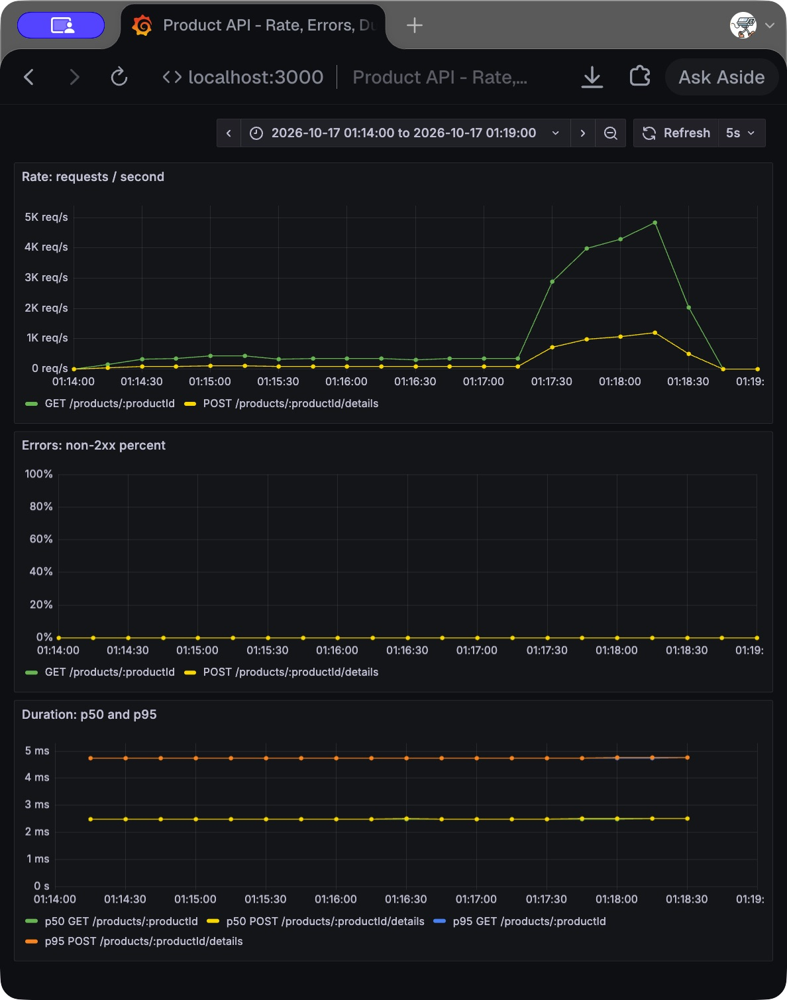

# Homework 5: Product API

Start with [What we did, in simple words](WHAT-WE-DID.md). Part I reading and Piazza work were already completed separately.

## Where everything is

| File/folder | Purpose |
| --- | --- |
| `api.yaml` | Original Canvas API contract |
| `src/product-service.go` | Go/Gin server, map, locks, validation, metrics, logs |
| `src/Dockerfile` | Builds the container |
| `terraform/` | Adapted instructor infrastructure: ECS, ECR, network, logs |
| `tests/check_api.py` | Checks all required HTTP responses |
| `src/product-service_test.go` | Input validation, stored updates, authentication, race tests |
| `load-tests/` | Locust tasks and sequential experiment runner |
| `observability/` | Prometheus scrape config and provisioned Grafana dashboard |
| `results/` | Actual responses, CSVs, HTML reports, screenshots, experiment times |

Infrastructure source: [instructor starter](https://github.com/RuidiH/CS6650_2b_demo), commit `54246e1fc8caf99cdda879da33b7b5dee3e27b48`. [My required fork](https://github.com/17-jd/CS6650_2b_demo). The adapted implementation is published in my fork and also kept under `Hw05` in my course workspace.

## Run locally

Requirements: Go 1.23 or newer, Python 3.13, Docker with Compose. The Docker build uses Go 1.25.

From the project directory (`Hw05` in the course workspace, or the root of the standalone fork):

```sh
cd src
go run .
```

In another terminal:

```sh
curl -i -H 'X-API-Key: hw5-local-demo' http://localhost:8080/products/12345
```

Stop `go run` before starting Docker on the same port. Then start the app and monitoring stack:

```sh
docker compose up -d --build
```

On this Mac, the installed standalone Compose command is `docker-compose`; it accepts the same arguments. Colima supplies the Docker daemon (`colima start --cpu 2 --memory 4 --disk 20`). Docker Desktop also works on other machines.

- App: `http://localhost:8080`
- Metrics: `http://localhost:8080/metrics`
- Prometheus: `http://localhost:9090`
- Grafana: `http://localhost:3000/d/product-red`

Grafana opens as a local, read-only anonymous viewer. All three ports bind to localhost. The dashboard and datasource are provisioned automatically. Prometheus and Grafana stay local; they are not deployed to AWS.

## API and every required response

The server starts with sample products **1 and 12345**. POST updates an existing product. Unknown IDs return 404. This makes the POST 404 response meaningful; the supplied YAML has no separate create-product operation. Data resets on restart. `/v1/products/...` also works, matching the specification's base URL.

The YAML allows API-key or bearer authentication. This server implements the API-key alternative. Use `X-API-Key: hw5-local-demo` for the classroom demo, or set `PRODUCT_API_KEY` before starting the server. Missing/incorrect authentication also returns 401, though the supplied endpoint response lists omit it.

Run these commands from `Hw05`:

```sh
export BASE_URL=http://localhost:8080

# GET 200: existing product
curl -i -H 'X-API-Key: hw5-local-demo' "$BASE_URL/products/12345"

# GET 404: missing product
curl -i -H 'X-API-Key: hw5-local-demo' "$BASE_URL/products/999"

# POST 204: valid update; response body is empty
curl -i -X POST -H 'X-API-Key: hw5-local-demo' -H 'Content-Type: application/json' \
  -d '{"product_id":12345,"sku":"ABC-123-XYZ","manufacturer":"Acme Corporation","category_id":456,"weight":1250,"some_other_id":789}' \
  "$BASE_URL/products/12345/details"

# POST 400: missing required fields
curl -i -X POST -H 'X-API-Key: hw5-local-demo' -H 'Content-Type: application/json' \
  -d '{}' "$BASE_URL/products/12345/details"

# POST 404: valid product data, unknown ID
curl -i -X POST -H 'X-API-Key: hw5-local-demo' -H 'Content-Type: application/json' \
  -d '{"product_id":999,"sku":"MISSING","manufacturer":"Acme","category_id":456,"weight":0,"some_other_id":789}' \
  "$BASE_URL/products/999/details"
```

To demonstrate both 500 responses, use **only the local test mode**:

```sh
ENABLE_TEST_ERRORS=true docker compose up -d app

# GET 500: deliberately trigger the recovery handler
curl -i -H 'X-API-Key: hw5-local-demo' -H 'X-Test-Error: 500' "$BASE_URL/products/12345"

# POST 500: deliberately trigger the recovery handler
curl -i -X POST -H 'X-API-Key: hw5-local-demo' -H 'X-Test-Error: 500' \
  -H 'Content-Type: application/json' -d '{}' "$BASE_URL/products/12345/details"

# Turn test mode off before normal tests
docker compose up -d app
```

For `go run`, use `ENABLE_TEST_ERRORS=true go run .` to enable the same local demonstration. AWS keeps fault injection off. These are deliberately induced 500s, not spontaneous load-test failures.

Saved real responses: [go run](results/go-run-responses.txt), [Docker](results/docker-responses.txt), [ECS](results/ecs-responses.txt). Both local modes demonstrated GET 200/404/500 and POST 204/400/404/500. ECS checks exclude deliberate 500s.

Validation checks all required fields, int32 bounds, positive IDs, nonnegative weight, SKU length 1–100, manufacturer length 1–200, and a matching path/body product ID. Missing/null weight is invalid; zero weight is valid. GET invalid IDs return 404 because the supplied GET contract has no 400 response. POST invalid IDs return 400. Errors include the required `error` and `message` fields.

## Deploy on another machine

1. Clone the standalone fork and use its repository root. If using the course repository instead, enter `Hw05`. Install Docker, Terraform, and AWS CLI. Start Docker.
2. Start AWS Academy Learner Lab. Copy its current temporary credentials to `~/.aws/credentials`, including the session token. Never put credentials in the repository. Check access with `aws sts get-caller-identity`.
3. Make an ignored `terraform/terraform.tfvars` file:

```hcl
allowed_cidrs = ["YOUR_PUBLIC_IPV4/32"]
# Docker Desktop/Linux:
docker_host = "unix:///var/run/docker.sock"
# On this Mac with Colima, use instead:
# docker_host = "unix:///Users/twinkle/.colima/default/docker.sock"
```

For a fresh deployment, use your own Learner Lab account. To manage this existing stack from a different machine, transfer its Terraform state privately or configure remote state; a fresh empty state cannot manage the already-created resources.

4. Deploy:

```sh
cd terraform
terraform init
terraform validate
terraform plan -out=hw5.tfplan
terraform apply hw5.tfplan
python3 service_url.py
```

Use the printed URL instead of `http://localhost:8080` in curl or Locust. Your client IP must match `allowed_cidrs`. If your network changes, update that ignored setting and apply again.

The region is `us-east-1`. This configuration uses the lab's existing `LabRole`, the default VPC/subnets, one Fargate task with 0.25 vCPU/512 MiB, CloudWatch logs, and an ECR repository. The image and ECS task both use **ARM64**, matching this Apple Silicon Mac. An Intel Docker host needs ARM64 emulation enabled, or can adapt the image/task architecture together. Image building and pushing happen through Terraform's Docker provider. The ECS service depends on the push completing and uses the immutable image digest, so a changed image produces a new task revision.

This is an HTTP classroom service restricted by source IP, with a published demo API key. It is not a production authentication/TLS design. Run one task because the products are in process memory; multiple independent tasks would not share updates.

After the interview, stop charges with `terraform destroy` from the same machine/state. ECR will refuse to delete a nonempty repository: remove its disposable homework image first, then repeat destroy. Keep Terraform state private and available for cleanup. Do not simply delete the state file.

## Run Locust again

```sh
python3 -m venv .venv
.venv/bin/pip install -r load-tests/requirements.txt
.venv/bin/python load-tests/run_tests.py http://localhost:8080 local
```

Replace the host and prefix with the deployed URL and `ecs` to repeat AWS experiments. The runner executes experiments **sequentially**: 50 HttpUsers, 50 FastHttpUsers, then 1,000 FastHttpUsers. Each lasts 60 seconds including ramp-up. The two 50-user runs spawn 10 users/sec and wait 0.1 seconds between tasks. Stress spawns 100 users/sec with no wait. All use the same approximately 80% GET / 20% POST mix.

Reads are likely to dominate a real product catalogue. A map offers average O(1) lookups, and the RWMutex permits simultaneous reads. Writes hold the exclusive lock briefly. An actual store would use persistent storage and could cache common reads.

The official [Locust performance documentation](https://docs.locust.io/en/stable/increase-performance.html) explains that HttpUser uses `requests`, while FastHttpUser uses `geventhttpclient` to reduce load-generator CPU usage. FastHttpUser can generate more traffic when client CPU is the bottleneck; it does not inherently make the server process each request faster. Network delay, server capacity, and the intentional wait can hide the difference.

## Monitoring and logs

The Grafana dashboard has a rate panel, a non-2xx error-percentage panel, and a duration panel with p50/p95 by endpoint. It uses a 30-second rate window and a five-second scrape interval. Duration comes from a Prometheus histogram; very fast requests share the first 5 ms bucket, so sub-5 ms quantiles are approximate. Locust measures end-to-end latency, while the server histogram measures time inside the application.

At idle, the request rate drops to zero and there is no new latency distribution. During load, rate rises and latency can increase. Normal successful workload errors should stay at zero. Input-validation errors in the separate response tests intentionally count as non-2xx errors.

**Use the dashboard** to spot changes in traffic, errors, and latency. **Use logs** to inspect individual requests and their outcomes after a problem occurs.

Measured results and screenshot links follow below.

## Actual results — October 17, 2026

**Current API:** `http://35.172.200.112:8080`. Terraform apply completed, with one running task and no pending tasks. [Final deployment verification](results/final-deployment.json) and [fresh API checks](results/ecs-final-responses.txt). Fault injection is off on AWS.

The deployed endpoint at test time was `http://18.205.26.175:8080`. It is reachable only from the configured client IP and can change when ECS replaces the task. Use `terraform/service_url.py` to find its current address. Terraform successfully deployed the service; see [apply output](results/terraform-apply.txt).

| Target | Client | Users | Requests/sec | Mean ms | p50 ms | p95 ms | Failures |
| --- | --- | ---: | ---: | ---: | ---: | ---: | ---: |
| Local | HttpUser | 1 | 9.36 | 3.73 | 3 | 6 | 0 |
| Local | HttpUser | 50 | 428.88 | 9.57 | 8 | 18 | 0 |
| Local | FastHttpUser | 50 | 430.19 | 8.82 | 7 | 18 | 0 |
| Local | FastHttpUser | 1,000 | 5,481.58 | 100.72 | 90 | 190 | 0 |
| ECS | HttpUser | 50 | 305.40 | 55.50 | 54 | 78 | 0 |
| ECS | FastHttpUser | 50 | 307.69 | 54.99 | 51 | 82 | 0 |
| ECS | FastHttpUser | 1,000 | 5,717.11 | 146.84 | 130 | 240 | 0 |

These are whole-run CSV aggregates, including ramp-up. The final HTML report may include a few additional requests completing during shutdown. One local baseline ran for 30 seconds; every other run lasted 60 seconds. Local Docker had a 0.5-CPU/256-MiB limit; ECS used 0.25 vCPU/512 MiB. The local and cloud numbers are different environments, not a hardware ranking.

**What changed:** On ECS at 50 users, FastHttpUser produced about 308 requests/sec versus about 306 for HttpUser; mean latency was about 55 ms for both. The difference is small. The 0.1-second task wait and network delay dominate at this load, so reduced client CPU does not create a large speedup. A single run per setting is not enough to establish statistical significance.

**Where pressure appeared:** At 1,000 ECS users with no task wait, p95 increased from about 77–81 ms to 240 ms, while throughput reached about 5,717 requests/sec. CloudWatch recorded CPU peaking at 83.5% in the 01:22 EDT minute, compared with about 7% in the preceding 50-user minute. This supports increased server pressure. There were no HTTP failures, so this test found degraded latency, not a crash point or a proven maximum capacity. [CPU evidence](results/ecs-CPUUtilization.json).

**Local limitation:** The local stress run raised a Locust warning that load-generator CPU exceeded 90%. Its approximately 5,482 requests/sec is therefore not proof of the server's maximum. The client and server also shared this Mac, and an image build overlapped part of the local comparison. The ECS comparison began after the image build finished. A follow-up capacity study should use repeated steady-state runs and multiple load-generator workers on separate hardware.

### Screenshots and original reports

- [ECS HttpUser, 50 users](results/ecs-http-50.png) · [full HTML report](results/ecs-http-50.html)
- [ECS FastHttpUser, 50 users](results/ecs-fast-50.png) · [full HTML report](results/ecs-fast-50.html)
- [ECS stress, 1,000 users](results/ecs-stress-1000.png) · [full HTML report](results/ecs-stress-1000.html)
- [Local stress HTML report](results/local-stress-1000.html)
- [Local experiment times and settings](results/local-timeline.json) · [ECS experiment times and settings](results/ecs-timeline.json)

### Grafana: idle versus loaded



The screenshot covers **01:14–01:19 EDT**. The two 50-user comparisons ran around 01:15–01:17, followed by the local 1,000-user stress run around 01:17–01:18. Traffic returns to zero afterward. Errors remain zero during the successful workload. The duration panel cannot distinguish most requests below its first 5 ms bucket, so its flat estimated quantiles should not be interpreted as exact handler timings. The [saved Prometheus data](results/prometheus-local-test.json) comes from this same window.

### Request logs from that same local stress run

The timestamps are UTC: 05:17 UTC is 01:17 EDT. [Full excerpt](results/request-log-excerpt.txt).

```json
{"duration_ms":0.046629,"endpoint":"/products/:productId/details","method":"POST","status":204,"time":"2026-10-17T05:17:12.904104797Z"}
{"duration_ms":0.011741,"endpoint":"/products/:productId/details","method":"POST","status":204,"time":"2026-10-17T05:17:12.904163755Z"}
{"duration_ms":0.027173,"endpoint":"/products/:productId","method":"GET","status":200,"time":"2026-10-17T05:17:12.904102827Z"}
{"duration_ms":0.006625,"endpoint":"/products/:productId","method":"GET","status":200,"time":"2026-10-17T05:17:12.904206736Z"}
```

The fields show the endpoint, HTTP method, status code, and duration in milliseconds for each request. No credentials or request bodies are logged.
